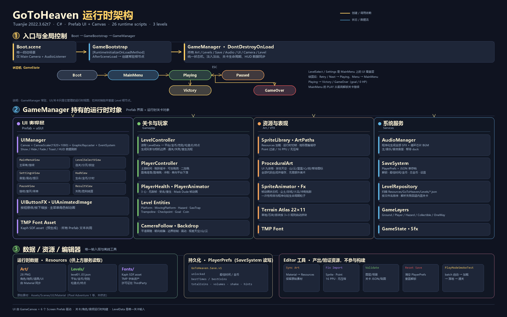
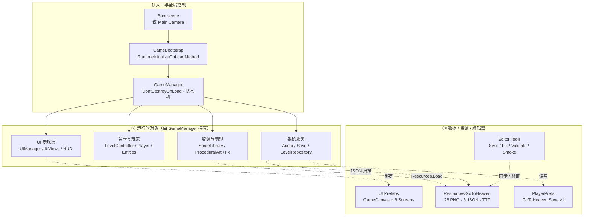
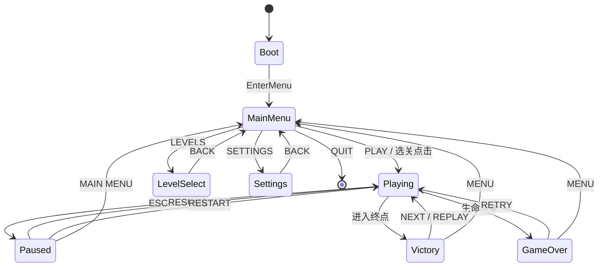
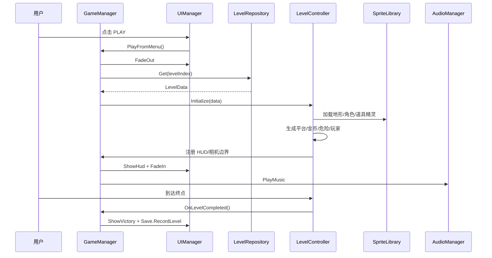

# GoToHeaven 架构



> 图片：`Docs/architecture.png`（2400×1500）。下方 Mermaid 为可编辑的文字版。

## 1. 分层概览



## 2. 游戏状态机

`LevelSelect` 与 `Settings` 是 `MainMenu` 上的 UI 覆盖层，不单独改变 `GameManager.State`。



## 3. 模块职责

| 层 | 模块 | 职责 |
| --- | --- | --- |
| 入口 | `Boot.scene` | 启动场景：相机 + `GameCanvas` Prefab 实例 |
| 入口 | `GameBootstrap` | `AfterSceneLoad` 创建常驻 `GameManager` |
| 全局 | `GameManager` | 状态机、转场、关卡生命周期、服务持有、HUD 同步 |
| UI | `GameCanvas.prefab` | Canvas/Scaler/Raycaster/EventSystem + 六个 Screen Prefab |
| UI | `UIManager` | 绑定场景或 Prefab 的 Canvas、切换界面、淡入淡出、Toast |
| UI | `MainMenuView` / `LevelSelectView` / `SettingsView` | 主菜单、选关、设置 Prefab 控制器 |
| UI | `HudView` / `PauseView` / `ResultView` | 生命/金币/计时、暂停、失败/胜利 Prefab 控制器 |
| UI | `UIButtonFX` / `UIAnimatedImage` / `UITheme` | 按钮动效、角色帧动画、颜色主题 |
| 关卡 | `LevelController` | 从 `LevelData` 生成平台/道具/玩家/相机边界 |
| 玩家 | `PlayerController` | 土狼时间、跳跃缓冲、可变跳高、二段跳、蹬墙跳、冲刺 |
| 玩家 | `PlayerHealth` / `PlayerAnimator` | 3 心、无敌帧、受击/重生、Mask Dude 帧动画 |
| 关卡 | `LevelEntities` | Platform、MovingPlatform、Hazard、SawTrap、Trampoline、Checkpoint、Goal、Coin |
| 相机 | `CameraFollow` / `Backdrop` | 平滑跟随、边界钳制、震动、视差天空/山/云 |
| 资源 | `SpriteLibrary` / `ArtPaths` | Resources 加载、运行时切帧、地形图集缓存 |
| 资源 | `ProceduralArt` | 天空/山/云等背景程序化图形（UI 已烘焙为 Sprite 资产） |
| 资源 | `SpriteAnimator` / `Fx` | 帧动画、尘土/彩纸/火花/冲刺残影 |
| 服务 | `AudioManager` | 程序化 SFX + 循环芯片 BGM，音量与暂停 duck |
| 服务 | `SaveSystem` | PlayerPrefs + JSON：解锁、最佳时间/金币、设置 |
| 服务 | `LevelRepository` | 扫描 `Resources/GoToHeaven/Levels/*.json` 并按文件名排序 |
| 服务 | `GameLayers` | Ground / Player / Hazard / Collectible / OneWay 图层 |
| 数据 | `LevelData` | 关卡 JSON 的序列化模型（平台/金币/危险/检查点/终点） |
| 编辑器 | `GoToHeavenEditor` | 同步 Material 素材、修复导入、验证工程、重置存档 |
| 编辑器 | `PlayModeSmokeTest` | 批处理 Play Mode 冒烟测试 |

## 4. 一次关卡的运行流程



## 5. 数据流

| 数据 | 来源 | 消费方 |
| --- | --- | --- |
| 关卡布局 | `Assets/Resources/GoToHeaven/Levels/*.json` | `LevelRepository` → `LevelController` |
| 角色/地形/道具图 | `Assets/Resources/GoToHeaven/Art/**`（由 `Assets/Scenes/UI/Material` 同步） | `SpriteLibrary` |
| UI 布局 | `Assets/Resources/GoToHeaven/UI/GameCanvas.prefab` + `Prefabs/*.prefab` | `GameManager` / `UIManager` |
| UI Sprite | `Assets/Resources/GoToHeaven/UI/Sprites/ui_*.png` | 界面 Prefab 的 Image 组件 |
| 字体 | `Assets/Resources/GoToHeaven/UI/Fonts/Kaph SDF.asset` | 界面 Prefab 的 TMP 文本 |
| 进度/设置 | `PlayerPrefs: GoToHeaven.Save.v1` | `SaveSystem` ↔ `UIManager` / `AudioManager` |
| 关卡顺序 | Resources 内文件名排序（level01/02/03） | `LevelRepository` / 选关界面 |

## 6. UI Prefab 结构

```text
Assets/Resources/GoToHeaven/UI/
├─ GameCanvas.prefab          Canvas + CanvasScaler + GraphicRaycaster + EventSystem + UIManager
├─ Prefabs/
│  ├─ MainMenu.prefab
│  ├─ LevelSelect.prefab
│  ├─ Settings.prefab
│  ├─ HUD.prefab
│  ├─ Pause.prefab
│  ├─ Result.prefab
│  └─ Fade.prefab
├─ Sprites/ui_*.png           九宫格面板/按钮/爱心/星星等烘焙 Sprite
└─ Fonts/Kaph SDF.asset       预生成 TMP 字体资产
```

- `Boot.scene` 内放置 `GameCanvas` 的 Prefab 实例。
- `GameManager` 启动时优先接管场景中的 `UIManager`；其他没有 Canvas 的场景会从 Resources 实例化 `GameCanvas.prefab`。
- 控制器只按对象名查找控件并绑定事件；改布局、颜色、字号、图片都在 Prefab 中完成。
- 关键名称（改名会断绑定）：
  `MainMenu/Play|Levels|Settings|Quit|Info`、
  `LevelSelect/LevelCard`（6 个）与 `Back|Previous|Next|Page`、
  `Settings/Panel/MASTER VOLUMESlider|MUSICSlider|SOUND EFFECTSSlider|ShakeToggle|HintToggle|Back`、
  `HUD/LevelPanel/LevelName|Timer`、`HUD/StatsPanel/Heart0..2|CoinText|Pause`、
  `Result/Panel/GameOverButtons/RETRY`、`Result/Panel/VictoryButtons/Next|Replay|Menu`。

## 7. 关键设计决策

1. **UI 用 Prefab/Canvas，玩法用运行时构建**：UI 布局与样式在 GameCanvas + 六个 Screen Prefab 中编辑；关卡、角色、平台与音频源由代码创建。这样既保留可视化编辑 UI 的工作流，也避开原工程预制体 GUID 失效的历史问题。
2. **LevelData 是唯一关卡输入**：新增关卡只需投放 JSON，不改代码；编辑器工具可校验。
3. **运行时切帧**：角色/道具的横向雪碧图按 32/64 像素切帧，不依赖导入器的 Sprite 矩形；地形按 3×3 规则拼块。
4. **程序化音频**：全部 SFX 与 BGM 由代码合成，工程不需要音频文件。
5. **UI 资产预生成**：九宫格面板、爱心、星星、锁、暂停图标等运行时 Sprite 已烘焙为 `UI/Sprites/ui_*.png`；TMP 字体已生成 `Kaph SDF.asset`，Prefab 直接引用，不再运行时创建字体。
6. **编辑器工具与运行时分离**：`Assets/Editor` 不参与构建；冒烟测试只在批处理中运行。

## 8. 验证

```text
GOTOTHEAVEN_SMOKE_PASS frames=66551 level=0 coins=0 time=1.26 grounded=True health=3
```

冒烟测试覆盖：启动 → 主菜单 → 加载 level01 → 玩家落地（grounded）→ 生命/计时/字体/地形加载 → 触发通关 → `Victory` 状态。


