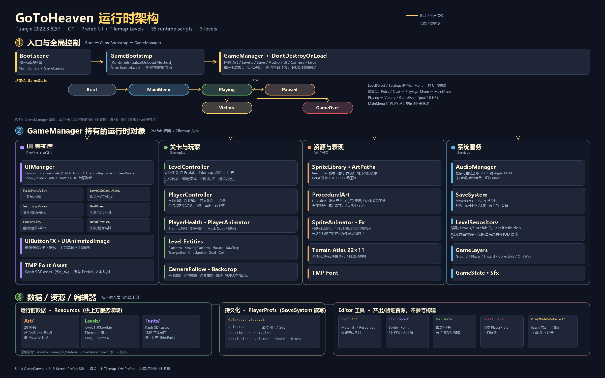

# GoToHeaven

一个基于 **团结引擎 / Tuanjie 2022.3.62t7（Unity 2022.3 LTS 分支）** 与 C# 的 2D 平台跳跃游戏框架。
所有美术来自工程内的 `Assets/Scenes/UI/Material`；UI 采用 **GameCanvas + 六个 Screen Prefab**，由 C# 控制器绑定数据；
关卡采用每关一个 **Tilemap 关卡 Prefab**；角色、音频和背景在运行时生成。

## 架构图



可编辑的文字版与模块说明：[Docs/ARCHITECTURE.md](Docs/ARCHITECTURE.md)。

## 快速开始

1. 用 **Tuanjie Hub** 打开项目目录 `GoToHeaven/GoToHeaven`（`ProjectVersion.txt` 对应 Tuanjie 2022.3.62t7）。
2. 打开 `Assets/Scenes/Boot.scene`（原 `SampleScene` 已重命名并清理）。
3. 点击 **Play**。

> 如果你打开工程时编辑器还停留在旧的 `SampleScene` 上，请重新打开一次 `Assets/Scenes/Boot.scene`。
> 游戏入口由 `GameBootstrap` 在场景加载后自动创建，因此在任何场景按 Play 都能启动，但 Boot 是正式入口。

## 操作

| 按键 | 功能 |
| --- | --- |
| `A` / `D` 或方向键 | 左右移动 |
| `Space` / `W` / `↑` | 跳跃（按住跳得更高；空中可二段跳） |
| `Shift` / `J` | 冲刺（地面或空中一次，带冷却与残影） |
| `S` / `↓` + `Space` | 从单向平台落下 |
| `Esc` | 暂停 / 继续 |
| `R` | 重新开始当前关卡 |
| `Enter` | 主菜单开始 / 结算后继续 |

## 已实现内容

- 角色：加速/减速、土狼时间、跳跃缓冲、可变跳跃高度、二段跳、贴墙滑落、蹬墙跳、冲刺、残影。
- 关卡：草地/石块/砖块主题的地形自动拼块，三个手工关卡，检查点、金币、尖刺、旋转锯、移动平台、跳床、终点门。
- 相机：平滑跟随、朝向前瞻、关卡边界钳制、屏幕震动。
- UI：主菜单、选关、HUD、暂停、设置、失败/胜利结算、淡入淡出、Toast；全部由 Prefab/Canvas 驱动。
- 音频：全部程序化生成，包含跳跃、金币、受伤、检查点、终点、弹跳、冲刺、点击和循环芯片音乐。
- 存档：`PlayerPrefs` + JSON，保存关卡解锁、最佳时间/金币、总金币、音量与设置。
- 场景：`Boot.scene` 包含相机和 `GameCanvas` 预制体实例，其余玩法内容在运行时生成。

## 目录结构

```
Assets/
  Editor/
    GoToHeavenEditor.cs          # 导入设置、验证、同步美术、重置存档
    PlayModeSmokeTest.cs         # 批处理 Play Mode 冒烟测试
  Resources/GoToHeaven/
    Art/                          # 从 Material 同步来的运行时可加载美术
    UI/
      GameCanvas.prefab           # Canvas + CanvasScaler + GraphicRaycaster + EventSystem + UIManager
      Prefabs/MainMenu..Result    # 六个独立界面 Prefab（含 Fade）
      Sprites/ui_*.png            # 烘焙后的九宫格/爱心/星星等 UI Sprite
      Fonts/Kaph SDF.asset        # 预生成的 TMP 字体资产
    Fonts/kaph_regular.ttf        # Kaph 源字体（TMP 动态字体的源文件）
    Levels/
      level01..03.prefab          # 三个关卡 Prefab（Tilemap + 道具）
      Tiles/                      # Tilemap 使用的 Tile 资产
      Sprites/                    # 关卡道具 Sprite
  Scenes/
    Boot.scene                   # 相机 + GameCanvas 实例
  Scripts/GoToHeaven/
    Core/                        # 启动、状态机、图层
    Data/                        # 关卡数据/加载、存档
    Art/                         # 精灵加载/切帧、程序化美术、动画、特效
    Player/                      # 控制器、生命、动画
    Level/                       # 关卡构建、实体、相机、视差背景
    UI/                          # 六个界面的绑定/刷新逻辑 + 特效组件
    Audio/                       # 程序化音频
  Scenes/UI/Material/            # 实际使用的源素材（已精简）
  ThirdParty/Kaph_Font/          # Kaph 字体 LICENSE

Docs/
  architecture.png               # 架构图
  ARCHITECTURE.md                # 架构说明 / Mermaid 文字版
```

## 关卡 Prefab / Tilemap 工作流

每关是一个独立 Prefab：

```text
Assets/Resources/GoToHeaven/Levels/
├─ level01.prefab          First Steps
├─ level02.prefab          Gap Garden
├─ level03.prefab          Sky Ascent
├─ Tiles/                  Tilemap 使用的 Tile 资产（草地/石块/砖块）
└─ Sprites/                金币、锯子、检查点等预制体用的 Sprite
```

每个关卡 Prefab 的结构：

```text
level01 (LevelController + LevelDefinition)
├─ PlayerSpawn
├─ Grid
│  └─ Terrain (Tilemap + TilemapCollider2D + CompositeCollider2D)
├─ OneWay ...             单向平台（Platform + BoxCollider2D + PlatformEffector2D）
├─ Mover ...              移动平台（MovingPlatform + Kinematic Rigidbody2D）
├─ Coin ...               金币
├─ Spikes ...             尖刺（Hazard + Trigger）
├─ Saw ...                移动锯（SawTrap）
├─ Trampoline ...         跳床
├─ Checkpoint ...         检查点
└─ Goal ...               终点
```

编辑方式：

- 双击 `level01.prefab` 进入 Prefab Mode。
- 地形直接用 **Tile Palette** 刷 `Tiles/` 里的 Tile；`Grid` 的 Cell Size 是 1。
- 金币、陷阱、移动平台、检查点、终点直接拖动/复制；数值在 Inspector 里改。
- `LevelDefinition` 管理 `id / displayName / subtitle / theme / parTime / killY / coinCount`。
- `PlayerSpawn` 标记出生点；`Goal` 是终点触发器。
- 新增关卡：复制一个关卡 Prefab，重命名（决定排序），改 `LevelDefinition`，然后放进 `Levels/` 即可，`LevelRepository` 会自动扫描。

运行时：

- `LevelRepository` 从 `Resources/GoToHeaven/Levels` 读取所有关卡 Prefab 的 `LevelDefinition`。
- `GameManager` 实例化选中的关卡 Prefab。
- `LevelController` 只负责生成玩家、绑定金币/检查点/终点、计算相机边界和处理通关/死亡。
- 地形碰撞来自 `TilemapCollider2D + CompositeCollider2D`，单向平台使用 `PlatformEffector2D`。
- 旧的 JSON 关卡数据已删除，Prefab 是唯一关卡来源。

## 添加/替换美术

运行时可加载的副本位于 `Assets/Resources/GoToHeaven/Art/`，实际使用的源文件保留在
`Assets/Scenes/UI/Material/Pixel Adventure 1/Free/`。未使用的素材包与子目录已删除。如果替换了源素材，使用编辑器菜单：

- `GoToHeaven/Sync Art From Material`：重新同步所需素材到 Resources。
- `GoToHeaven/Fix Art Import Settings`：把资源设为 Sprite、Point 过滤、16 PPU、无压缩。
- `GoToHeaven/Validate Project`：检查图层、场景、关卡 Prefab 与贴图导入。
- `GoToHeaven/Reset Save Data`：清除解锁与设置。
- 批处理 Play Mode 冒烟测试：见 `Assets/Editor/PlayModeSmokeTest.cs` 顶部注释。

美术包与字体的授权文件：`Assets/ThirdParty/Kaph_Font/LICENSE.txt`（Kaph 字体）。
Pixel Adventure 实际使用的源文件保留在 `Assets/Scenes/UI/Material`；未使用的素材包已删除。

## UI Prefab 工作流

- 总入口：`Assets/Resources/GoToHeaven/UI/GameCanvas.prefab`
  - 包含 `Canvas`、`CanvasScaler`(1920×1080)、`GraphicRaycaster`、`EventSystem`、`UIManager`
  - 子节点：`MainMenu`、`LevelSelect`、`Settings`、`HUD`、`Pause`、`Result`、`Fade`
- 六个界面也可以单独打开编辑：
  `Assets/Resources/GoToHeaven/UI/Prefabs/*.prefab`
- `Boot.scene` 中已经放了 `GameCanvas` 的 Prefab 实例；运行时 `GameManager` 优先使用场景中的 Canvas，
  找不到时才从 Resources 实例化 `GameCanvas.prefab`。
- 修改布局、颜色、字号、图片都在 Prefab 里完成；脚本只负责按钮绑定、显示/隐藏和数据刷新。

> 脚本按对象名绑定控件，改名会断引用。需要保留的关键名称：
> `MainMenu/Play|Levels|Settings|Quit`、`LevelSelect/LevelCard`（6 个）、`LevelSelect/Back|Previous|Next|Page`、
> `Settings/Panel/MASTER VOLUMESlider`、`MUSICSlider`、`SOUND EFFECTSSlider`、`ShakeToggle`、`HintToggle`、`Back`、
> `HUD/LevelPanel/LevelName|Timer`、`HUD/StatsPanel/Heart0..2|CoinText|Pause`、
> `Result/Panel/GameOverButtons/RETRY`、`Result/Panel/VictoryButtons/Next|Replay|Menu`。

## 设计说明

- **UI 与关卡都用 Prefab**：UI 用 GameCanvas + 六个 Screen Prefab；关卡每关一个 Prefab，地形是 Tilemap，道具是 Prefab 内的对象。玩家和音频源仍由代码生成。
- **关卡生命周期**：`LevelRepository` 读取关卡 Prefab 的 `LevelDefinition`，`GameManager` 实例化 Prefab，`LevelController` 负责玩家/检查点/终点/相机。
- **Canvas 生命周期**：`GameManager` 启动时优先接管 Boot 场景里的 `GameCanvas`，并把它挂到常驻根节点下；
  在其他场景按 Play 时会回退到 Resources 中的 `GameCanvas.prefab`。
- **图层**：`Ground`、`Player`、`Hazard`、`Collectible`、`OneWay` 已写入 `TagManager`；
  若图层尚未重载，`GameLayers` 会用数字索引兜底。
- **TMP 字体**：使用预生成的 `Assets/Resources/GoToHeaven/UI/Fonts/Kaph SDF.asset`，Prefab 文本直接引用；
  不再在运行时动态创建字体。
- **存档 key**：`GoToHeaven.Save.v1`。

## 关于被删除的起始模块

原工程里 `Assets/Scenes/UI/Material/startUI.prefab` 引用的 5 个 GUID（按钮精灵、自身 Prefab GUID 等）
在工程中全部不存在，`SampleScene` 中的 PrefabInstance 也因此是断的；它无法作为可用的启动界面。
该预制体及其场景实例已删除，`SampleScene.scene` 重命名为 `Assets/Scenes/Boot.scene`，
现在是“相机 + GameCanvas Prefab 实例”的启动场景。
`Assets/Scenes/UI/Material` 中的原始美术全部保留。

## 验证

- 运行时代码通过独立 Roslyn 编译（引用 Tuanjie 的 UnityEngine/UI/TextMeshPro 程序集），无错误。
- 关卡 JSON 已转为 3 个 Tilemap 关卡 Prefab，Prefab 中无丢失脚本引用。
- 在隔离副本上用团结引擎批处理跑通 **Play Mode 冒烟测试**：
  启动 → 主菜单 → 加载 level01 Prefab → 验证玩家落在 Tilemap 地形上（`grounded=True`）、
  生命值为 3、计时器推进、TMP 字体/精灵/地形加载成功 → 触发通关 → 进入 `Victory` 状态。
  实测输出：`GOTOTHEAVEN_SMOKE_PASS frames=58630 level=0 coins=0 time=1.25 grounded=True health=3`。
  命令见 `Assets/Editor/PlayModeSmokeTest.cs` 顶部注释。
- 冒烟测试在项目副本中运行，不会影响你正在打开的工程；副本与临时文件已清理。


